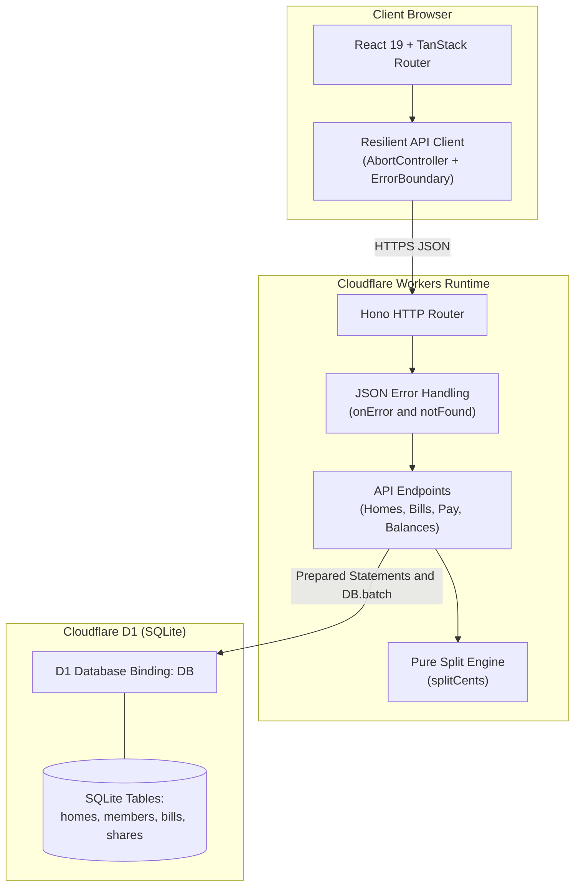
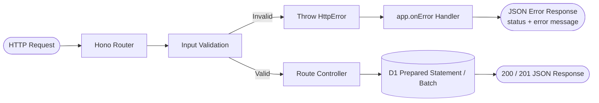
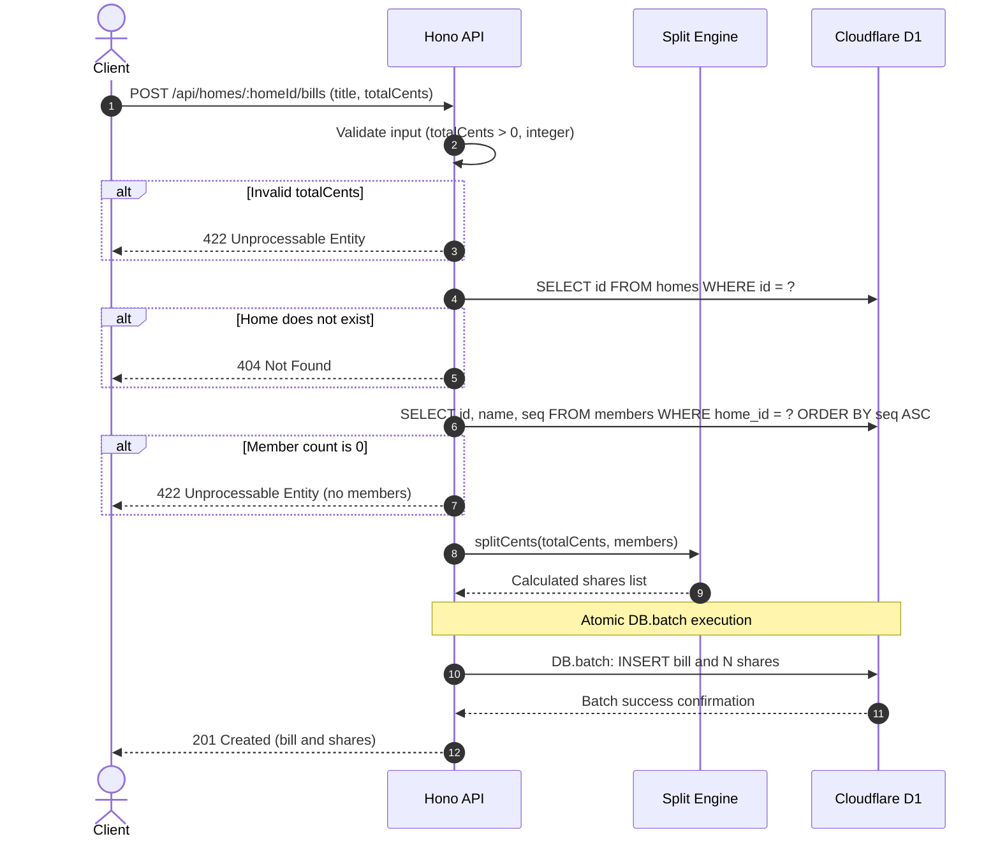
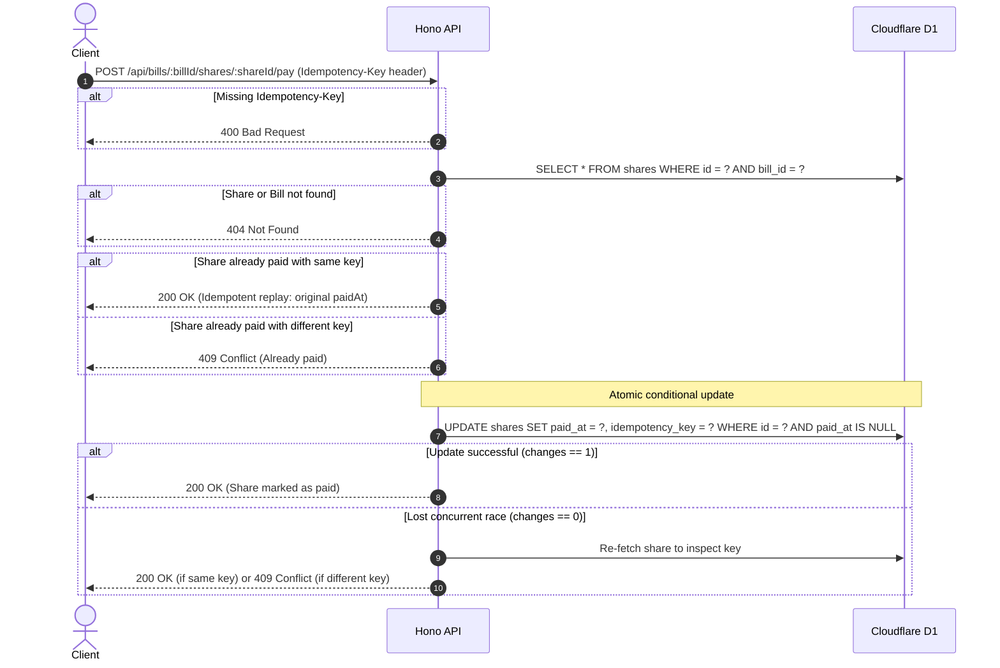
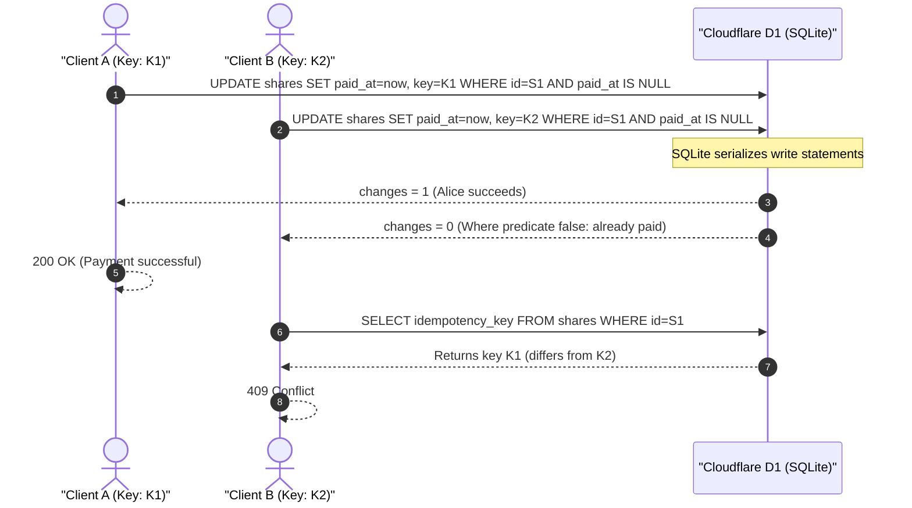
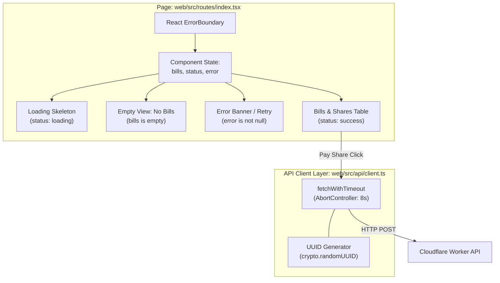

# System Architecture & Technical Design

## 1. System Overview

The Shared Bill Splitter is built as a lightweight, edge-native monorepo consisting of a React single-page frontend and a Hono API hosted on Cloudflare Workers, backed by Cloudflare D1 (serverless SQLite).



---

## 2. Components and Responsibilities

| Component | Location | Responsibility |
|---|---|---|
| **Entry & Middleware** | `api/src/index.ts` | Mounts routes, defines `c.notFound()` and `app.onError()` ensuring standard `{ "error": string }` format. |
| **Error Domain** | `api/src/errors.ts` | Provides typed `HttpError(status, message)` class for intentional HTTP error responses. |
| **Validation Layer** | `api/src/validation.ts` | Parses request bodies, asserts types, validates positive whole cents, and enforces non-empty strings. |
| **Split Domain** | `api/src/split.ts` | Pure function `splitCents(totalCents, members)`. Calculates floor base and allocates remainder cents in `seq` order. |
| **Route Handlers** | `api/src/routes/*.ts` | Implements endpoint business logic, executes D1 prepared statements, and coordinates atomic writes. |
| **Web API Client** | `web/src/api/client.ts` | Typed `fetch` wrapper supporting `AbortController` timeouts, typed `ApiError`, and JSON error decoding. |
| **Web UI** | `web/src/routes/index.tsx` | Single-page bill management view with loading skeletons, empty states, error banners, and share payment actions. |

---

## 3. Request Lifecycle



1. **Incoming Request**: Arrives at Cloudflare Worker via `exports.default.fetch`.
2. **Routing & Dispatch**: Hono matches the HTTP method and pathname.
3. **Validation**: Body/header parser validates types and business rules; invalid inputs throw typed `HttpError` (e.g. 400 or 422).
4. **Data Access**: Handler executes pre-compiled SQL queries with parameterized bindings via `env.DB.prepare()`.
5. **Atomic Mutation**: Multi-row operations use `env.DB.batch()`; state changes use atomic conditional `UPDATE`.
6. **Response / Error Interception**: Successful handlers return `c.json(data, status)`. Any thrown exception is caught by `app.onError()`, ensuring internal stack traces are never exposed.

---

## 4. Sequence Diagrams

### 4.1 Create Bill Flow
Creating a bill requires atomicity: the bill and all member shares must be committed together.



---

### 4.2 Pay Share Flow (Idempotent & Race-Safe)
Payment must handle fresh payments, identical retries (replay), conflicts, and non-existent entities.



---

### 4.3 Concurrent Payment Race ("Two requests at once")



---

## 5. Concurrency and Idempotency Strategy

1. **Why Conditional `UPDATE` and Not Read-Then-Write**:
   - A naive implementation (`SELECT` -> check if unpaid -> `UPDATE`) is susceptible to Time-Of-Check to Time-Of-Use (TOCTOU) race conditions. Two concurrent requests can both read `paid_at = NULL` before either writes, resulting in double charges or overwrites.
   - An atomic single-statement `UPDATE shares SET paid_at = ?, idempotency_key = ? WHERE id = ? AND paid_at IS NULL` guarantees that the SQLite engine evaluates the predicate and executes the write atomically.
2. **Where Idempotency State Is Stored**:
   - The idempotency state is stored directly on the `shares` row (`idempotency_key` column).
   - This eliminates the need for external caches (like Redis) and guarantees zero distributed state divergence: if the share is paid, its key is permanently recorded alongside `paid_at`.
3. **Why No Application-Level Locks**:
   - Cloudflare Workers are stateless and distributed across hundreds of edge locations; in-memory locks do not work across workers.
   - Cloudflare D1 coordinates writes through primary SQLite instances. Relying on SQLite's ACID guarantees and atomic row-level predicates is both simpler and race-proof.

---

## 6. Error-Handling Strategy

- **Typed `HttpError`**: Errors thrown from business logic or validation carry an explicit HTTP status code:
  ```ts
  throw new HttpError(422, 'totalCents must be a positive integer')
  ```
- **Centralized `onError` Middleware**:
  ```ts
  app.onError((err, c) => {
    if (err instanceof HttpError) {
      return c.json({ error: err.message }, err.status)
    }
    console.error('Unhandled error:', err)
    return c.json({ error: 'Internal server error' }, 500)
  })
  ```
- **Centralized `notFound` Middleware**:
  ```ts
  app.notFound((c) => c.json({ error: 'Not found' }, 404))
  ```
- **Zero Leakage**: Internal database error details and stack traces are suppressed in HTTP responses and sent solely to Worker observability logs.

---

## 7. Frontend Architecture



- **Resilient Request Execution**: All network calls pass through a wrapper creating an `AbortController` with an 8-second timeout.
- **Stable Idempotency Key**: When a user clicks "Pay", an idempotency key is generated and held in component state for that specific action. Retrying a timed-out or interrupted network request safely reuses the key.
- **Fail-Safe Share State**: If a payment call returns 409, 500, or times out, the share remains unpaid in the UI and an explicit banner alerts the user.

---

## 8. Testing Architecture

- **Runtime Simulation**: Vitest operates inside the actual Miniflare / Cloudflare Workers environment using `@cloudflare/vitest-plugin`.
- **Database Isolation**: The test harness runs `applyD1Migrations` before each test suite runs, ensuring clean SQLite tables.
- **Dual Test Layers**:
  1. *Visible Test Suite*: `homes.test.ts`, `bills.test.ts`, `payments.test.ts` (kept unmodified).
  2. *Custom Hardening Suite* (`edge-cases.test.ts`): Tests true concurrent `Promise.all` payment races, constraint enforcement, and error responses.

---

## 9. Trade-offs and Known Limitations

1. **Member Addition During Bill Creation**:
   - *Behavior*: Bill creation reads members, computes splits, and inserts shares in a batch. If a new member is added between the read and the batch insert, the bill is split among the members existing at read time.
   - *Rationale*: Avoids complex distributed locking on the home entity; bills represent a point-in-time expense for existing occupants.
2. **No Optimistic UI Updates**:
   - *Behavior*: The web UI disables the pay button and shows a loading state until the server confirms payment.
   - *Rationale*: Optimistic updates for financial transactions risk displaying false success if the server rejects the payment with 409 Conflict.
3. **SQLite Single-Writer Concurrency**:
   - *Behavior*: Under extremely high write concurrency, SQLite serializes write transactions.
   - *Rationale*: Perfectly suited for home-scale bill splitting with zero operational overhead and rock-solid ACID guarantees.
