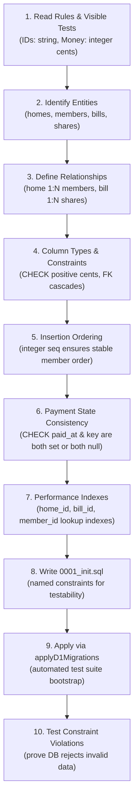
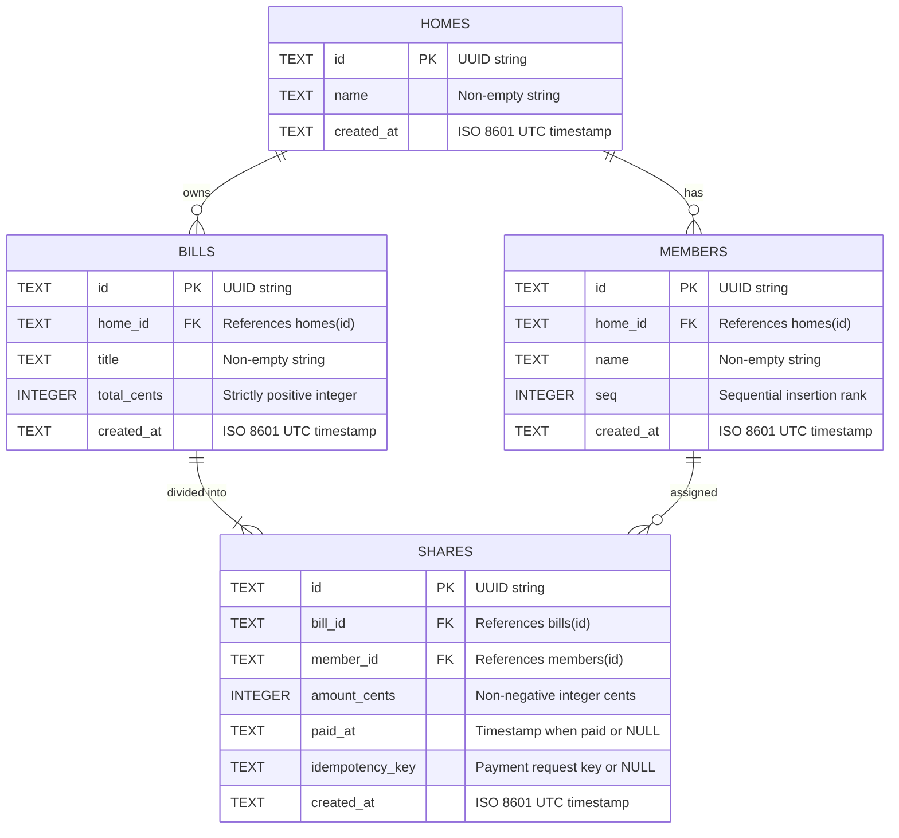

# Database Schema and Design

This document details the database schema, design process, relational integrity rules, and key queries for the Shared Bill Splitter on Cloudflare D1 (SQLite).

---

## 1. Schema Design Process



---

## 2. Entity-Relationship (ER) Diagram



---

## 3. Table-by-Table Schema Specification

### 3.1 `homes`
Stores the flat or apartment group.
- `id` (`TEXT PRIMARY KEY`): Unique UUIDv4 identifier.
- `name` (`TEXT NOT NULL`): Display name of the home (e.g. "Flat 4B").
- `created_at` (`TEXT NOT NULL`): Timestamp of creation.

### 3.2 `members`
Stores flatmates residing in a specific home.
- `id` (`TEXT PRIMARY KEY`): Unique UUIDv4 identifier.
- `home_id` (`TEXT NOT NULL`): References `homes(id)` with `ON DELETE CASCADE`.
- `name` (`TEXT NOT NULL`): Name of the member (e.g. "Asha").
- `seq` (`INTEGER NOT NULL`): Monotonically increasing sequence number for ordering members within a home.
- `created_at` (`TEXT NOT NULL`): Timestamp of member addition.

### 3.3 `bills`
Stores expenses split among members of a home.
- `id` (`TEXT PRIMARY KEY`): Unique UUIDv4 identifier.
- `home_id` (`TEXT NOT NULL`): References `homes(id)` with `ON DELETE CASCADE`.
- `title` (`TEXT NOT NULL`): Short description of the expense (e.g. "Electricity").
- `total_cents` (`INTEGER NOT NULL`): Total expense in whole cents (strictly positive integer).
- `created_at` (`TEXT NOT NULL`): Timestamp of bill creation.

### 3.4 `shares`
Stores individual portion of a bill allocated to a specific member.
- `id` (`TEXT PRIMARY KEY`): Unique UUIDv4 identifier.
- `bill_id` (`TEXT NOT NULL`): References `bills(id)` with `ON DELETE CASCADE`.
- `member_id` (`TEXT NOT NULL`): References `members(id)` with `ON DELETE CASCADE`.
- `amount_cents` (`INTEGER NOT NULL`): Share amount in whole cents.
- `paid_at` (`TEXT NULL`): UTC timestamp when marked paid; NULL if unpaid.
- `idempotency_key` (`TEXT NULL`): Header key provided during payment; NULL if unpaid.
- `created_at` (`TEXT NOT NULL`): Timestamp of share creation.

---

## 4. Constraint Catalogue

The schema defines **10 named constraints** to ensure data integrity at the database layer independently of API validation:

| Constraint Name | Table | Rule / Definition | What It Prevents | Proof Test / Scenario |
|---|---|---|---|---|
| `chk_homes_name_nonempty` | `homes` | `LENGTH(TRIM(name)) > 0` | Blank or whitespace-only home names | Insert home with empty string rejected |
| `chk_members_name_nonempty` | `members` | `LENGTH(TRIM(name)) > 0` | Blank or whitespace-only member names | Insert member with empty string rejected |
| `chk_bills_title_nonempty` | `bills` | `LENGTH(TRIM(title)) > 0` | Blank bill titles | Insert bill with whitespace title rejected |
| `chk_bills_total_cents_positive` | `bills` | `total_cents > 0` | Bills with 0, negative, or invalid amounts | `bills.test.ts` line 57 (0, -100 rejected) |
| `chk_shares_amount_cents_nonneg` | `shares` | `amount_cents >= 0` | Negative share allocations | Direct SQL insert with negative cents fails |
| `chk_shares_payment_state` | `shares` | `(paid_at IS NULL AND idempotency_key IS NULL) OR (paid_at IS NOT NULL AND idempotency_key IS NOT NULL)` | Partial payment states (key without timestamp or timestamp without key) | Direct SQL update setting only `paid_at` fails |
| `fk_members_home` | `members` | `FOREIGN KEY (home_id) REFERENCES homes(id) ON DELETE CASCADE` | Members associated with non-existent homes | `homes.test.ts` line 25 (returns 404) |
| `fk_bills_home` | `bills` | `FOREIGN KEY (home_id) REFERENCES homes(id) ON DELETE CASCADE` | Bills associated with non-existent homes | `bills.test.ts` line 67 (returns 404) |
| `fk_shares_bill` | `shares` | `FOREIGN KEY (bill_id) REFERENCES bills(id) ON DELETE CASCADE` | Shares orphaned from deleted bills | Deleting bill cascades and removes shares |
| `fk_shares_member` | `shares` | `FOREIGN KEY (member_id) REFERENCES members(id) ON DELETE CASCADE` | Shares assigned to non-existent members | Invalid member ID rejected |
| `uq_shares_bill_member` | `shares` | `UNIQUE(bill_id, member_id)` | Duplicate shares for the same member on one bill | Duplicate member share insert rejected |
| `uq_members_home_seq` | `members` | `UNIQUE(home_id, seq)` | Ordering ties between members of the same home | Duplicate sequence number in a home rejected |

---

## 5. Architectural Decisions & Rationale

1. **Why `seq` integer ordering instead of timestamps**:
   - High-throughput tests or batch scripts can insert members within the same millisecond. Relying on `created_at` timestamps risks non-deterministic sorting order due to identical timestamps.
   - An explicit monotonically incremented `seq` guarantees immutable, deterministic first-in-first-out order.
2. **Why integer cents (`INTEGER`)**:
   - Floating-point representations (IEEE 754 `REAL` / `FLOAT`) introduce fractional cent rounding inaccuracies (e.g. `0.1 + 0.2 = 0.30000000000000004`).
   - All currencies are stored as whole integer cents ($1.00 = 100), guaranteeing exact conservation of split amounts.
3. **Why `chk_shares_payment_state`**:
   - Enforces state machine atomicity at the database tier. A share cannot be half-paid; either both `paid_at` and `idempotency_key` are recorded, or neither is.
4. **Foreign Key Enforcement & Cascades**:
   - Cloudflare D1 enables SQLite foreign keys by default. `ON DELETE CASCADE` guarantees referential hygiene if test fixtures delete homes.

---

## 6. Three Key Queries

### 6.1 Batch Creation of Bill and Shares
Executed atomically using `env.DB.batch([...])`:
```sql
-- 1. Insert bill
INSERT INTO bills (id, home_id, title, total_cents, created_at)
VALUES (?, ?, ?, ?, ?);

-- 2. Insert calculated shares (1 statement per member)
INSERT INTO shares (id, bill_id, member_id, amount_cents, paid_at, idempotency_key, created_at)
VALUES (?, ?, ?, ?, NULL, NULL, ?);
```

### 6.2 Atomic Conditional Payment
Guarantees race-safety without application-level locking:
```sql
UPDATE shares
SET paid_at = ?,
    idempotency_key = ?
WHERE id = ?
  AND bill_id = ?
  AND paid_at IS NULL;
```
If `result.meta.changes === 1`, the update succeeded. If `result.meta.changes === 0`, another request already completed payment or the share does not exist.

### 6.3 Balances Calculation via `LEFT JOIN`
Calculates total outstanding debts per member across all bills in a home:
```sql
SELECT 
    m.id AS memberId,
    m.name AS name,
    COALESCE(SUM(s.amount_cents), 0) AS outstandingCents
FROM members m
LEFT JOIN shares s 
    ON s.member_id = m.id 
   AND s.paid_at IS NULL
WHERE m.home_id = ?
GROUP BY m.id, m.name, m.seq
ORDER BY m.seq ASC;
```
The `LEFT JOIN` ensures members with 0 unpaid shares are correctly returned with `outstandingCents: 0` rather than omitted.

---

## 7. Migration Protocol

1. **File Convention**: Place numbered SQL scripts in `api/migrations/` using format `000N_description.sql` (e.g. `0001_init.sql`).
2. **Immutability**: Once committed and applied, never modify an existing migration file. Always create a new sequential file (`0002_...`) for schema updates.
3. **Automated Application**:
   - In production / local dev: `wrangler d1 migrations apply DB --local`.
   - In test harness: `api/test/apply-migrations.ts` runs `applyD1Migrations(env.DB, env.TEST_MIGRATIONS)` before tests run.
