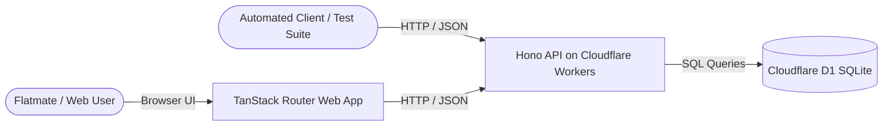

# Software Requirements Specification (SRS)

## 1. Purpose and Scope

The **Shared Bill Splitter** is a lightweight, reliable web service and single-page application designed for housemates living in a shared flat. It tracks members of a home, splits bills evenly down to the cent, tracks member balances, and allows individual shares to be paid safely under concurrent or repeated network requests.

### Out of Scope
- User authentication, sessions, and role-based permissions.
- Editing or deleting existing homes, members, bills, or shares.
- Multiple currencies or fractional cent representations (strictly integer cents).
- Pagination, infinite scroll, and background job notifications.

---

## 2. Users and Actors

- **Flatmate (Web User)**: Navigates the single-page interface to view bills, examine share distributions, and pay their unpaid share with immediate feedback.
- **API Client**: Automated test runner or external service interacting directly with REST endpoints via standard JSON payloads.

---

## 3. Functional Requirements

- **FR-1 (Create Home)**: The system shall accept `POST /api/homes` with `{ "name": string }` and return `201 Created` with `{ id, name }`.
- **FR-2 (Add Member)**: The system shall accept `POST /api/homes/:homeId/members` with `{ "name": string }` and return `201 Created` with `{ id, homeId, name }`. Returns `404` if `homeId` does not exist.
- **FR-3 (Create Bill)**: The system shall accept `POST /api/homes/:homeId/bills` with `{ "title": string, "totalCents": number }`. Returns `201 Created` with `{ id, homeId, title, totalCents, shares: [...] }`.
- **FR-4 (Even Split & Remainder Distribution)**: When creating a bill, the system shall divide `totalCents` by member count $N$:
  $$\text{base} = \lfloor \text{totalCents} / N \rfloor, \quad \text{remainder} = \text{totalCents} \pmod N$$
  The first $\text{remainder}$ members in insertion order (`seq` ascending) receive $\text{base} + 1$ cents; the rest receive $\text{base}$ cents.
- **FR-5 (Initial Share State)**: All newly created shares must initialize with `paidAt: null`.
- **FR-6 (Pay Share)**: The system shall accept `POST /api/bills/:billId/shares/:shareId/pay` requiring an `Idempotency-Key` header. Returns `200 OK` with `{ id, memberId, amountCents, paidAt }`.
- **FR-7 (Idempotent Payment Replay)**: Submitting the identical `Idempotency-Key` for an already paid share shall return `200 OK` with the exact original payment record and timestamp without double-charging.
- **FR-8 (Payment Conflict)**: Submitting a payment request for an already paid share with a different idempotency key shall return `409 Conflict`.
- **FR-9 (Member Balances)**: The system shall provide `GET /api/homes/:homeId/balances`, returning `{ balances: [{ memberId, name, outstandingCents }] }` in member insertion order.
- **FR-10 (List Bills with Shares)**: The system shall provide `GET /api/homes/:homeId/bills` returning all bills and their associated shares for the frontend display.
- **FR-11 (Web UI States)**: The web client shall render distinct **loading** (skeleton/spinner), **empty** (no bills/members), and **error** (API failure banner) states.
- **FR-12 (Web Payment Resilience)**: The web UI shall generate a stable UUID idempotency key per payment attempt, disable double clicks, keep the share unpaid if the request fails, and remain functional if the API is slow or returns 500.

---

## 4. Business Rules

- **BR-1 (Integer Currency)**: All monetary figures are stored and processed strictly as whole cents (e.g. \$10.00 = `1000`). Floating-point money is prohibited.
- **BR-2 (Remainder Allocation Order)**: Remainder cents are allocated strictly in the order members were added to the home (`seq` ascending).
- **BR-3 (Conservation of Total)**: The sum of all shares generated for a bill must strictly equal `totalCents`.
- **BR-4 (Member Sequence Invariance)**: Member addition order is immutable and defines the sequence of balances and remainder priority.
- **BR-5 (Idempotency Contract)**: An `Idempotency-Key` uniquely identifies a payment intent. Re-executing with the same key is a safe read of the prior result.
- **BR-6 (Concurrency Single Winner)**: When multiple requests attempt to pay the same share simultaneously, database constraints and atomic conditional updates ensure exactly one transaction succeeds.

---

## 5. Non-Functional Requirements

- **NFR-1 (Data Integrity & Atomicity)**: Creating a bill and its corresponding shares must execute atomically in a single `DB.batch()` transaction. Payment transitions must execute via atomic conditional `UPDATE ... WHERE paid_at IS NULL`.
- **NFR-2 (Type Safety)**: Zero usage of `any`. Strict TypeScript compiler compliance across `api` and `web`.
- **NFR-3 (Uniform Error Contract)**: All errors, including route not found (404) and unhandled exceptions (500), must respond with Content-Type `application/json` and body `{ "error": string }`.
- **NFR-4 (Client Resilience)**: Frontend network calls must feature timeout protection (`AbortController`, default 8000ms) and top-level React `ErrorBoundary`.
- **NFR-5 (Quality Standards)**: Code must pass Biome formatting, linting, and all unit/integration tests (`pnpm check && pnpm typecheck && pnpm test`).

---

## 6. Error Catalogue

| Endpoint | Condition | Status | Response Body |
|---|---|---|---|
| `POST /api/homes` | Empty/missing name | `400 Bad Request` | `{"error": "Home name is required"}` |
| `POST /api/homes/:homeId/members` | Home not found | `404 Not Found` | `{"error": "Home not found"}` |
| `POST /api/homes/:homeId/members` | Empty/missing name | `400 Bad Request` | `{"error": "Member name is required"}` |
| `POST /api/homes/:homeId/bills` | Home not found | `404 Not Found` | `{"error": "Home not found"}` |
| `POST /api/homes/:homeId/bills` | Home has 0 members | `422 Unprocessable Entity` | `{"error": "Cannot create bill for home with no members"}` |
| `POST /api/homes/:homeId/bills` | `totalCents` $\le 0$, non-integer, or null | `422 Unprocessable Entity` | `{"error": "totalCents must be a positive integer"}` |
| `POST /api/bills/:billId/shares/:shareId/pay` | Missing `Idempotency-Key` header | `400 Bad Request` | `{"error": "Idempotency-Key header is required"}` |
| `POST /api/bills/:billId/shares/:shareId/pay` | Bill or share not found | `404 Not Found` | `{"error": "Share not found"}` |
| `POST /api/bills/:billId/shares/:shareId/pay` | Already paid with different key | `409 Conflict` | `{"error": "Share has already been paid"}` |
| `GET /api/homes/:homeId/balances` | Home not found | `404 Not Found` | `{"error": "Home not found"}` |
| `GET /api/homes/:homeId/bills` | Home not found | `404 Not Found` | `{"error": "Home not found"}` |
| `*` (Any route) | Route does not match | `404 Not Found` | `{"error": "Not found"}` |
| `*` (Any route) | Uncaught exception / DB failure | `500 Internal Server Error` | `{"error": "Internal server error"}` |

---

## 7. Traceability Matrix (7 Mandatory Cases)

| # | Mandatory Case (from README) | Requirement | Implementation / Architecture | Proof Test |
|---|---|---|---|---|
| 1 | A home with no members | FR-3, BR-2 | Reject bill creation if member count is 0 | `api/test/bills.test.ts:49` ("rejects a home with no members") |
| 2 | Amount that is zero, negative, or not whole | FR-3, BR-1 | Validation reject non-positive integer cents with 422 | `api/test/bills.test.ts:57` ("rejects the amount %j") |
| 3 | Amount that does not divide evenly | FR-4, BR-2, BR-3 | `splitCents(total, members)` distributes remainder to earliest `seq` | `api/test/bills.test.ts:14` ("gives the extra cents to the first members...") |
| 4 | Same payment request sent twice | FR-7, BR-5 | Replay check: returns stored `paidAt` and original payload | `api/test/payments.test.ts:41` ("returns the same answer when same key sent twice...") |
| 5 | Two members paying same share concurrently | FR-8, BR-6 | Atomic `UPDATE ... WHERE paid_at IS NULL` with `changes() == 1` check | `api/test/payments.test.ts:55` & `api/test/edge-cases.test.ts` |
| 6 | Bill or share does not exist | FR-6 | Query share verification before update; 404 if missing | `api/test/payments.test.ts:64, 72` ("returns 404 when share/bill does not exist") |
| 7 | API returns 500 or slow; web does not crash | FR-11, FR-12, NFR-4 | `AbortController` timeout, React `ErrorBoundary`, error banners | `web/src/routes/index.tsx` & manual resilience simulation |

---

## 8. Assumptions & Technical Decisions

| Topic | Decision / Assumption | Basis |
|---|---|---|
| **Identifier Generation** | Standard UUIDv4 string (`crypto.randomUUID()`) | Confirmed by tests (`expect.any(String)`). |
| **Member Sequence** | Integer autoincrement `seq` determines insertion order | Confirmed by tests (independent of clock skew). |
| **Timestamp Format** | ISO 8601 UTC string (`new Date().toISOString()`) | Confirmed by tests (`expect.any(String)`). |
| **Balance Representation** | Strict object format `{ memberId, name, outstandingCents }` | Confirmed by `payments.test.ts` line 88 exact `toEqual`. |
| **Bill Ordering on Web** | Bills listed newest first (`created_at DESC`) | Our choice for user experience. |
